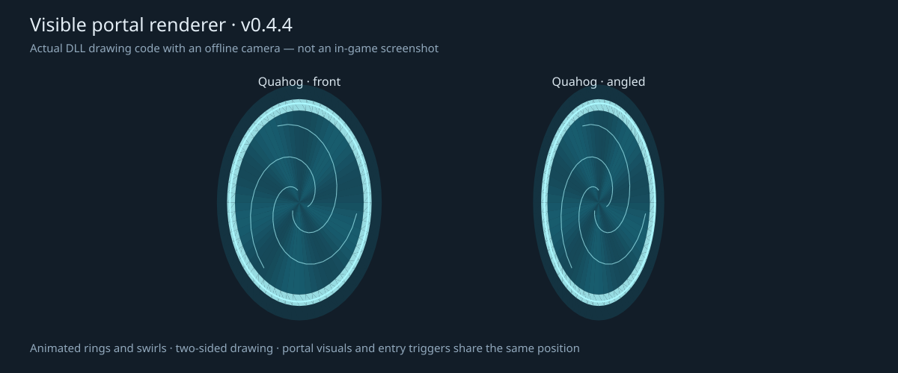

# Quahog Mod

A standalone Quahog map mod for the Windows x64 Super Mario Sunshine PC port / SMS Launcher. By **Randyadr**.

**Version 0.4.4.** The ZIP includes the native DLL, map assets, complete mod source, setup scripts, offline tests, and third-party licenses.

## Download

[**Download Quahog Mod v0.4.4**](https://github.com/randyadr/Quahog---Map-SMS-Port-/raw/refs/heads/main/Quahog_Mod_v0.4.4.zip)

Extract the ZIP before installing. [SHA-256 checksum](SHA256SUMS.txt).

## Install

1. Close the game. In SMS Launcher, open **Settings → Mods → Open mods folder**.
2. Copy the `quahog-native` folder into that Mods folder.
3. Enable **Quahog**, then press Play.
4. If map memory needs increasing, follow the startup message and restart the game once.

When upgrading an older installation, remove its old `quahog-native/runtime` folder before copying these files. Keep any custom `python-path.txt` and your mod data. Enable only one Quahog edition at a time.

Compatible installed x64 Python 3.10+ is reused. If it is missing, the mod downloads and verifies the official Python installer, installs it for the current Windows user, then continues map preparation. Internet is needed for that first installation. No Python runtime or installer EXE is bundled.

## Controls

| Control | Action |
| --- | --- |
| F6 | Enter Quahog from Delfino Plaza |
| F8 | Return to Plaza |
| F10 | Rescue to the Quahog entrance |
| F1 → Mods → Quahog → Place portal here | Save the portal at your current Plaza position |

Walking through the cyan portals also travels between the maps. Automatic entrance placement searches the market wall between the coconut and papaya stalls; manual placement is available if that scan cannot resolve the location.



The preview is rendered by the actual portal drawing code with an offline camera. It is not an in-game screenshot.

## Build and checks

The ZIP contains `quahog-native/BUILD.txt` with the Zig 0.13.0 Windows DLL command. After extracting the ZIP, run offline checks from the mod directory:

```sh
cd quahog-native
python tests/run_checks.py
```

This release was rebuilt with warnings treated as errors. All 38 Python tests and eight C++ suites passed, including SDK 1.3/1.4 address/undefined-behavior sanitizer checks. The map assets are byte-for-byte unchanged from v0.4.3. Windows execution and in-game behavior were not tested for this release.

## Details and credits

Included inside the ZIP's `quahog-native` folder:

- `README.txt` — installation, setup, compatibility and troubleshooting
- `CHANGELOG.txt` — version history
- `SECURITY_NOTES.txt` — security and Python setup details
- `VALIDATION.json` — build and offline validation record
- `licenses/` — third-party licenses

Requires a compatible user-supplied Sunshine GMSE01 or Eclipse GMSE04 disc. The game executable and ISO are not modified. Single-player only. This map build does not include the old custom missions, NPCs, dialogue or Shine rewards.

Converted world assets originate from the supplied Skin Selector 2.14.165 assets. Third-party asset ownership is not claimed. Mod work and integration: Randyadr.
