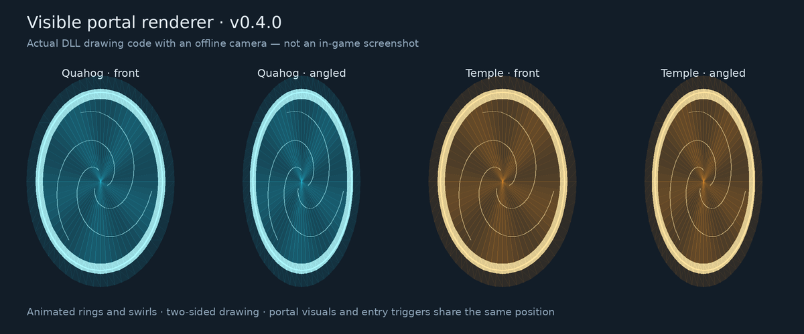

# Quahog Mod — Native C

A standalone Quahog map mod for the Windows x64 Super Mario Sunshine PC port / SMS Launcher. By **Randyadr**.

**Current version: 0.5.1.** The mod and map preparation are written in C11. Python, a Python installer, and an internet connection are no longer required. This update also fixes the **“Invalid file size”** startup error when inspecting large Skin Selector `sms.exe` builds.

## Download

[**Download Quahog Mod v0.5.1 — Native C + large EXE fix**](https://github.com/randyadr/Quahog---Map-SMS-Port-/raw/refs/heads/main/Quahog_Mod_v0.5.1_Native_C_EXE_Fix.zip)

The ZIP contains the compiled Windows x64 DLL, map assets, full C source, SDK headers, and offline tests. Use this install ZIP for the current version; the older **0.4.4** entry in Releases uses the previous Python setup. [SHA-256 checksum](SHA256SUMS.txt).

## Install or update

1. Close the game and extract the ZIP.
2. In SMS Launcher, open **Settings → Mods → Open mods folder**.
3. Copy the extracted `quahog-native` folder into Mods. Merge folders and replace files when updating. Keep your existing `data` folder and saved `quahog-portal.txt` placement.
4. Enable **Quahog**, then press Play. Enable only one Quahog copy at a time.
5. If startup asks for a memory-setting restart, close the game and press Play once more.

The old mod-local `tools/`, `runtime/`, Python setup files, and C++ sources are no longer used. They may be removed from an older installation. Shared Python installations are unaffected. No compiler or extra setup is needed to play.

## What changed

- All plugin and map-preparation logic now runs as compiled C11 in `quahog_native.dll`.
- No Python installation, downloads, helper processes, or preparation activity during ordinary gameplay.
- Large game executables are inspected through a read-only file mapping with a 64-bit file size. The map-asset size cap no longer rejects large Skin Selector executables.
- Map geometry, textures, and collision assets are unchanged from the supplied v0.4.3 package.

The game executable and ISO are not modified. See the [changelog](quahog-native/CHANGELOG.txt) and [installation and troubleshooting guide](quahog-native/README.txt).

## Controls

| Control | Action |
| --- | --- |
| F6 | Enter Quahog from Delfino Plaza |
| F8 | Return to the Plaza episode you entered from |
| F10 | Rescue to the Quahog entrance |
| F1 → Mods → Quahog → Place portal here | Save the portal at your current Plaza position |

Walking through the cyan portals also travels between the maps. Automatic placement searches the coconut/papaya market gap and nearby collision. Saved placement takes priority; manual placement and F6 remain available when the scan cannot resolve a position.



This is the original offline portal rendering, not an in-game screenshot.

## Source, building, and tests

Browse the [C source](quahog-native/src), [SDK](quahog-native/sdk), [tests](quahog-native/tests), and [build instructions](quahog-native/BUILD.txt) directly on GitHub. There are no Python or C++ source files in the current checkout or install ZIP.

The large map binaries are stored in the install ZIP. After cloning or using **Code → Download ZIP**, extract the included `Quahog_Mod_v0.5.1_Native_C_EXE_Fix.zip` into a separate temporary folder. Copy only its `quahog-native/assets` folder into the checkout's `quahog-native` folder. This restores the assets without replacing source edits. The compiled DLL and synthetic test fixtures are already present as normal repository files. No Python checkout helper is needed.

To rebuild with Zig 0.13.0, open `quahog-native` and run `BUILD_WINDOWS.cmd` on Windows, or:

```sh
zig cc -target x86_64-windows-gnu -std=c11 -O2 -Wall -Wextra -Werror -shared -Isdk src/quahog_native.c src/qcore.c src/qformats.c src/qhost.c -luser32 -o bin/windows-x86_64/quahog_native.dll
```

Run the offline tests from `quahog-native` on Linux with a C compiler:

```sh
sh tests/run_checks.sh
```

The Windows x64 DLL compiled with warnings treated as errors. Native tests passed for format parsing, hashing, cache repair, portal behavior, and simulated host APIs 1.3, 1.4, and 1.5. Sparse executable tests passed at 300 MiB and 3 GiB, including symbol tables beyond 2 GiB. Memory and bounds checks passed on the tested paths. See [VALIDATION.json](quahog-native/VALIDATION.json) and [test results](quahog-native/tests/last-checks.log).

**This is a test release:** actual Windows game execution and Windows file operations have not been tested here. The DLL is unsigned; Defender has not been tested.

## Compatibility and credits

Requires a compatible user-supplied Sunshine/Eclipse game, Windows x64 native mod API 1.x, and the host symbols listed in the [mod README](quahog-native/README.txt). Single-player only. This map build does not add the old custom missions, NPCs, dialogue, or Shine rewards.

Converted world assets originate from the supplied Skin Selector 2.14.165 assets. Third-party asset ownership is not claimed. SDK and compiler-library licenses are retained in [licenses](quahog-native/licenses). Mod work and integration: Randyadr.
